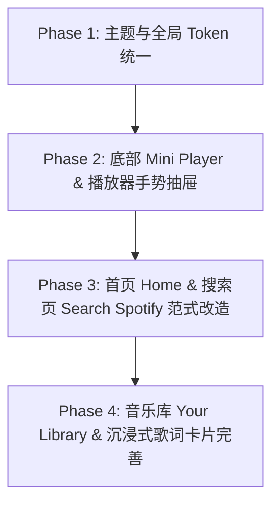

# LX Music Mobile -> Spotify 风格重构设计指南 (design.md)

本文档系统性地梳理了将 **LX Music Mobile** 改造为 **Spotify 现代设计语言与交互体验（UI/UX）** 的完整设计方案、功能裁减策略、开源项目借鉴指南及分阶段实施路线图。

---

## 目录
1. [重构愿景与核心设计原则](#1-重构愿景与核心设计原则)
2. [Spotify UI/UX 资源与设计资产获取途径](#2-spotify-uiux-资源与设计资产获取途径)
3. [GitHub 开源参考项目与组件库](#3-github-开源参考项目与组件库)
4. [功能裁减与精简策略（保留 vs 砍掉/隐藏）](#4-功能裁减与精简策略保留-vs-砍掉隐藏)
5. [核心 UI/UX 与交互逻辑改造方案](#5-核心-uiux-与交互逻辑改造方案)
6. [设计规范与 Design Tokens (色彩/排版/圆角)](#6-设计规范与-design-tokens)
7. [分阶段实施路线图 (Roadmap)](#7-分阶段实施路线图-roadmap)

---

## 1. 重构愿景与核心设计原则

- **Content-First（内容沉浸）**：弱化繁杂的控制面板和密集文字列表，突出大尺寸专辑封面、歌手头像与卡片式视觉流。
- **Dark Elegance（纯粹暗黑美学）**：以 Spotify 标志性的炭黑（`#121212`）与深灰阶梯为基底，搭配高对比度的 Spotify 标志绿（`#1DB954`）。
- **Fluid Gestures（丝滑手势交互）**：将传统割裂的“切页”转变为手势驱动的流畅体验（如 Mini Player 上滑展开为全屏播放器、歌单页向下滚动时标题平滑吸顶折叠）。
- **Dynamic Atmosphere（动态氛围感）**：根据当前播放歌曲的专辑封面实时提取主色调，生成自适应高斯模糊/渐变流光背景。

---

## 2. GitHub 顶级开源 Spotify Clone 项目参考（源码级借鉴）

针对无法使用官方/Figma 设计平台的场景，可以直接参考 GitHub 上成熟的 React Native 开源仿制项目，直接提取其页面布局、样式常数（StyleSheet）、组件结构与手势动画：

### 2.1 完整 App 级开源项目（直接参考页面与组件代码）

| 开源项目 / 仓库地址 | 核心技术栈 | 重点可抄/借鉴的代码模块 |
| :--- | :--- | :--- |
| **[`dhunanyan/spotify-clone`](https://github.com/dhunanyan/spotify-clone)** | React Native + Expo | 1. **首页布局**（`HomeScreen`）：2x3 问候胶囊卡片、水平横滑歌单流；<br>2. **搜索页**（`SearchScreen`）：彩色大磁贴网格；<br>3. **歌单详情页**（`PlaylistScreen`）：大封面 + 绿色圆形播放主按钮 + 列表项。 |
| **[`AndresXI/RN-Spotify-Clone-Redesigned`](https://github.com/AndresXI/RN-Spotify-Clone-Redesigned)** | React Native + TypeScript | 1. **全套现代暗黑 UI 组件**（Button, Card, Slider, List）；<br>2. **播放器界面（PlayerScreen）**：大圆角黑胶唱片/封面、流光背景与控制器。 |
| **[`Savinvadim1312/SpotifyClone`](https://github.com/Savinvadim1312/SpotifyClone)** | React Native + Expo | 1. **经典底部 Mini Player 胶囊**（`PlayerWidget`）：悬浮在 TabBar 上方，歌曲进度底线；<br>2. **分类与歌单卡片组件**（`AlbumCategory`, `SongListItem`）。 |
| **[`marcelo-is/spotify-react-native-clone`](https://github.com/marcelo-is/spotify-react-native-clone)** | RN + Reanimated | 1. **Mini Player 上滑抽屉**：丝滑无缝过渡到全屏播放器的 Reanimated 手势处理；<br>2. **歌词高亮滚动组件**。 |

---

## 3. 核心交互组件与视觉资产开源实现方案

无需寻找外部图片或设计软件，直接通过以下开源库与项目内置库组合即可 100% 还原 Spotify：

### 3.1 底部 Mini 播放条 + 平滑展开抽屉（Bottom Sheet）
- **推荐方案**：使用 **`@gorhom/react-native-bottom-sheet`** 或基于 **`react-native-reanimated`** 的手势交互。
- **参考实现**：Software Mansion 官方 Spotify 交互教程与代码：
  - Mini 播放器作为 BottomSheet 的折叠状态（Snap point: `64px`，带 `8px` 圆角和深灰半透明背景）；
  - 手势向上拖动直接展开为全屏播放器（Snap point: `100%`），歌曲封面、进度条与控制按钮通过插值（Interpolation）平滑放大展开。

### 3.2 封面自适应渐变背景 (Dynamic Ambient Gradient)
- **推荐方案**：结合 **`react-native-image-colors`** + **`react-native-linear-gradient`**。
- **实现逻辑**：
  ```ts
  // 从当前歌曲封面提取 Vibrant 主色调
  import ImageColors from 'react-native-image-colors';
  const colors = await ImageColors.getColors(picUrl, { fallback: '#121212' });
  const dominantColor = colors.platform === 'android' ? colors.dominant : colors.primary;
  // 渐变背景：[dominantColor, '#121212', '#121212']
  ```

### 3.3 矢量图标体系（本项目已内置 `react-native-vector-icons`）
项目自带 `react-native-vector-icons`（`10.2.0`），无需找 SVG，直接使用内置图标即可完美对应 Spotify 官方图标：

| 功能 | 推荐使用的内置 Icon 库与名称 | 视觉效果 |
| :--- | :--- | :--- |
| **Spotify Logo** | `Entypo: 'spotify'` | 经典波浪圆标 |
| **播放 / 暂停** | `Ionicons: 'play-circle-sharp'` / `'pause-circle-sharp'` | 绿色实心大圆播放键 |
| **上一曲 / 下一曲** | `Ionicons: 'play-skip-back-sharp'` / `'play-skip-forward-sharp'` | 极简双竖线跳歌键 |
| **随机播放 (Shuffle)** | `Ionicons: 'shuffle-sharp'` | 交叉箭头，激活时显绿色加小圆点 |
| **循环模式 (Repeat)** | `Ionicons: 'repeat-sharp'` / `'repeat-outline'` | 环形箭头，单曲循环带 "1" |
| **喜欢 / 收藏 (Heart)** | `Ionicons: 'heart'` (已收藏) / `'heart-outline'` (未收藏) | Spotify 经典绿心 |
| **更多菜单 (More)** | `Ionicons: 'ellipsis-horizontal'` | 三点菜单 |
| **实时歌词 (Lyrics)** | `MaterialCommunityIcons: 'card-text-outline'` | 歌词卡片图标 |
| **设备 / 音源 (Devices)** | `MaterialCommunityIcons: 'speaker-multiple'` | 设备流转/音源切换 |

---


## 4. 功能裁减与精简策略（保留 vs 砍掉/隐藏）

当前 LX Music 功能非常全面，但存在较多为极客/高级用户设计的复杂选项与陈旧列表式排版。重构为 Spotify 风格需遵循 **“核心听歌极致化，非核心功能隐蔽化”** 原则：

### 4.1 建议砍掉 / 裁撤的功能 (Remove)
1. **繁杂的多主题与自定义背景图**：
   - 现状：内置数十种配色和自定义背景图，容易导致 UI 风格碎片化且与 Spotify 暗黑极简风冲突。
   - 改造：只保留 **Spotify Pure Dark（经典纯黑）** 与 **Spotify Light（可选极简浅色）** 两种主题，其余花哨主题直接砍掉。
2. **多余的横屏/车机独立布局分支**：
   - 现状：代码中存在大量 `Horizontal` 目录和横屏专属逻辑分支。
   - 改造：先聚焦移动端竖屏（Portrait）的单手操作体验，简化代码维护复杂度。
3. **老旧列表式九宫格排行榜堆叠**：
   - 现状：各平台排行榜以多级列表堆叠，视觉陈旧。
   - 改造：转化为 Spotify 风格的 “Top 50 - Global / Regional” 探索式圆角大卡片。

### 4.2 建议隐蔽化 / 简化整合的功能 (Simplify & Hide)
1. **用户自定义音源 (User API) 界面**：
   - 改造前：在首页或搜索页存在显眼的音源切换选择器，破坏沉浸感。
   - 改造后：将音源选择收敛到「设置 -> 音源管理」中，或在搜索时默认聚合展示，点击播放时后台自动调度，弱化底层技术名词。
2. **下载管理与复杂文件系统树**：
   - 改造前：有单独的下载任务管理器页面。
   - 改造后：融入「Your Library (音乐库)」中的 “Downloaded (已下载)” 筛选标签，点击即可离线播放，无需展示繁琐的文件路径与传输面板。
3. **桌面悬浮歌词设置**：
   - 改造前：在界面多处有悬浮窗设置入口。
   - 改造后：桌面悬浮窗保留为「设置」中的高级开关；而在 App 内，主推 **Spotify 原生卡片式实时滚动歌词**。

---

## 5. 核心 UI/UX 与交互逻辑改造方案

### 5.1 底部浮动 Mini 播放条 + 平滑手势抽屉 (Floating Mini Player & Bottom Sheet)
- **Mini Player 样式**：
  - 不再使用贴底的固定工具条，采用**悬浮胶囊卡片（Floating Pill）**，浮动在底部 Tab Bar 上方，带细微圆角（`8px`）、深灰半透明磨砂质感与极简进度微线。
  - 左侧微缩方形封面、中间歌曲名与歌手（跑马灯滚动）、右侧仅保留「收藏 Heart」与「播放/暂停」按钮。
- **展开手势 (Gesture)**：
  - 点击或向上拖动 Mini Player，通过手势平滑过渡放大为全屏播放器（Now Playing View）。
  - 下滑全屏播放器顶部折叠条，无缝收起至 Mini Player。

### 5.2 首页 (Home) 信息架构重构
- **顶部问候区 (Greeting Header)**：
  - 根据时间显示 `"Good morning"` / `"Good afternoon"` / `"Good evening"`。
  - 下方排布 6 块 **2x3 常用入口/最近播放胶囊卡片**（带小封面 + 标题）。
- **水平横向滑动卡片流 (Horizontal Carousels)**：
  - `Recently Played`（近期常听）：横向滑动的正方形歌单卡片。
  - `Made For You` / `Top Playlists`（推荐歌单）：圆角方形封面 + 副标题。
  - `Popular Artists`（热门歌手）：圆形头像 + 居中姓名。

### 5.3 搜索与探索页 (Search & Browse All)
- **顶部搜索栏**：常驻输入框，支持热搜词提示与实时联想。
- **探索分类彩色大磁贴 (Genre & Mood Tiles)**：
  - 2 列网格卡片布局，每张卡片拥有专属明亮背景色（如流行 Pop: `#8C1932`，摇滚 Rock: `#E91429`，白噪音/助眠: `#477D95`）。
  - 卡片右下角 45 度旋转放置一张代表性封面，营造极强视觉冲击力。

### 5.4 音乐库 (Your Library)
- **顶部快速筛选胶囊 (Filter Pills)**：`Playlists`、`Artists`、`Albums`、`Downloaded`。
- **排序与展示切换**：支持「最近播放 / 最近添加 / 字母排序」切换，支持「紧凑列表视图」与「大网格视图」切换。

### 5.5 全屏播放详情页 (Now Playing Screen)
- **自适应渐变背景 (Dynamic Ambient Gradient)**：
  - 提取当前专辑封面主色，顶部呈高饱和度主色向底部 `#121212` 渐变过渡。
- **封面展示**：居中大圆角正方形（`border-radius: 12px`），轻微外发光阴影。
- **沉浸式滚动歌词卡片 (Lyrics Card)**：
  - 播放器下方内嵌半屏/全屏实时歌词卡片，随时间轴逐句自动居中并高亮变白，未唱到的歌词呈现半透明暗灰（`rgba(255,255,255,0.4)`）。
  - 点击歌词卡片支持全屏卡拉 OK 模式，并提供歌词分享卡片生成功能。

---

## 6. 设计规范与 Design Tokens

### 6.1 核心调色板 (Color Palette)

```css
/* Spotify Core Colors */
--spotify-green: #1DB954;
--spotify-green-hover: #1ED760;
--spotify-black: #121212;
--spotify-pure-black: #000000;
--spotify-card-bg: #181818;
--spotify-card-hover: #282828;
--spotify-subtext: #B3B3B3;
--spotify-white: #FFFFFF;
--spotify-divider: #2A2A2A;
```

### 6.2 排版规范 (Typography)
- **推荐字体**：优先使用系统无衬线字体（Android: `Roboto` / `Inter`，iOS: `San Francisco`）。
- **字阶与字重**：
  - **Large Title**：`24px - 28px`，`Bold (700)`，用于首页问候、歌单大标题。
  - **Section Title**：`18px - 20px`，`Bold (700)`，用于横向列表模块标题。
  - **Card Title / Song Title**：`14px - 15px`，`SemiBold (600)`，纯白文本。
  - **Artist / Subtext**：`12px - 13px`，`Regular (400)`，次级灰文本 (`#B3B3B3`)。

### 6.3 形状与圆角规范 (Border Radius)
- **Buttons / Pills**：`9999px`（全胶囊圆角）。
- **Album / Playlist Card**：`8px` - `12px`。
- **Artist Avatar**：`50%`（完全正圆）。
- **Mini Player Container**：`8px`。

---

## 7. 分阶段实施路线图 (Roadmap)



### 阶段一：主题体系与全局 Design Tokens 改造 (Phase 1)
- 清理冗余主题文件，确立全局 Spotify Dark 主题规范（`#121212` 黑色底色 + `#1DB954` 主题绿）。
- 统一下游所有按钮、卡片、文字层级的全局样式变量。

### 阶段二：底部 Mini Player 与全屏播放手势抽屉重构 (Phase 2)
- 引入或优化手势交互，将现有固定底部播放条重构为悬浮胶囊。
- 全屏播放器集成专辑主色提取（Dynamic Gradient），重构播放进度条与核心控制按钮。

### 阶段三：首页 (Home) 与搜索页 (Search) 布局重构 (Phase 3)
- 首页增加顶部问候语、近期播放 2x3 网格与横向滑动推荐歌单/歌手模块。
- 搜索页改造为彩色大磁贴探索流。
- 弱化非必要设置项，将音源切换隐蔽至设置页。

### 阶段四：音乐库 (Your Library) 与沉浸式歌词卡片 (Phase 4)
- 重构歌单/收藏/本地音乐为结构化的音乐库筛选面板。
- 实现内嵌式实时卡片歌词滚动与分享功能，完成全流程交互体验打磨。
